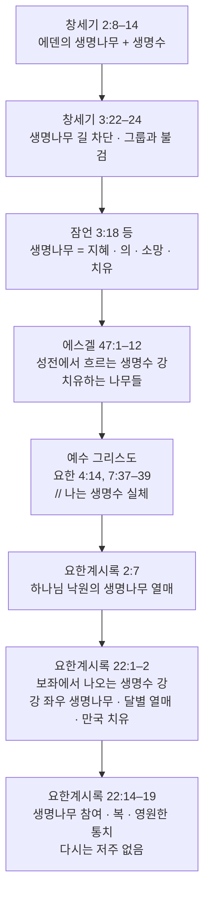

# 성경필사와 함께한 질문들2.docx

> [!NOTE]

> **소스 출처**: 성경공부

---

## 🏷 NotebookLM 자동 태그 (한국어 번역)

**키워드**: 구약 모형론, 성경의 도량형, 무화과나무 저주, 성경적 청지기 원리, 천상 보좌 이미지

**한줄 요약**

> 이 포괄적인 신학 안내서는 성경적 주제의 연속성을 탐구하며, **구약의 예표들**을 **예수 그리스도**의 생애와 사역 안에서 이루어진 궁극적인 성취와 연결합니다. 아담, 이삭, 다윗과 같은 구약의 인물들이 **선지자, 제사장, 왕**으로서의 그리스도의 역할을 나타내는 "그림자"로서 어떻게 기능하는지를 면밀히 설명하는 동시에, **성경의 도량형**을 현대 단위로 환산하여 실용적인 배경 지식을 제공합니다. 신약으로 넘어가서는 **말라 버린 무화과나무의 상징성**이나 **불의한 청지기**에게 내려진 역설적인 칭찬과 같은 복잡한 서사들에 대해 깊이 있는 주석적 통찰을 제시하며, 이러한 이야기들을 영적 결실과 영원한 안목에 관한 교훈으로 풀어냅니다. 마지막으로, 이 책은 구원의 거대한 "생물학적" 궤적을 추적하여, 창세기에서의 상실로부터 요한계시록에 묘사된 **새 예루살렘**에서의 웅장한 회복에 이르기까지 **생명나무와 생명수의 강**이 거쳐 간 여정을 생생하게 보여줍니다.

---

## 📋 상세 분석 (소스_프롬프트.txt 기반)

---

title: "성경필사와 함께한 질문들2.docx"

aliases: []

tags: [source, mcp-extracted]

type: document

---

# 📄 성경필사와 함께한 질문들2.docx

## 📌 요약 (Executive Summary)

- 본 문서는 구약과 신약 성경 전반에 걸친 주요 신학적 질문 및 난해 구절, 역사·문화적 배경, 도량형 환산, 상징 체계에 대해 단계별 질문과 상세 해설 형식으로 작성된 종합 지식 추출 데이터이다.

- 구약 인물(아담, 이삭, 요셉, 멜기세덱, 다윗)의 그리스도 예표, 성경 도량형의 현대 단위 환산, 무화과나무 저주 사건의 상징성, 코르반 및 세마포를 입은 청년 등 마가복음의 구체적 정황, 구레네 시몬의 십자가 사건 등의 신학적 의미를 상세히 규명한다.

- 마태·마가·누가·요한 복음서 간의 서사 차이(아기 예수의 행적, 베드로의 소명, 포도주 이적) 및 비유 해석(불의한 청지기, 새 포도주와 새 가죽부대)을 복음서 저자들의 신학적 목적과 연결하여 해설한다.

- 엔돌의 신접한 여인 사건과 점진적 계시, 갈라디아서 수신 지역(남/북 갈라디아설), 개역개정 성경 글자 수 통계, 도고의 의미, 베드로후서의 타락 천사, 니골라당의 정체, 보좌 환상(에스겔 그룹, 이사야 스랍, 계시록 네 생물) 및 성경 전체의 생명나무·생명수 흐름을 무손실 구조로 정립한다.

## 🗺️ 원문 구조 (Document Map)

1. 구약 인물들의 예수님 사역 예표 (아담, 이삭, 요셉, 멜기세덱, 다윗)

2. 성경 속 도량형 단위의 현대 길이·높이·무게 단위 환산

3. 무화과나무 저주의 이유와 상징적 의미

4. 마태복음과 마가복음의 무화과나무 사건 비교 분석

5. 코르반(Qorban)의 개념과 마가복음 7장의 적용

6. 마가복음의 세마포를 입은 알몸 청년 기록 이유

7. 구레네 사람 시몬이 억지로 십자가를 지게 된 사건의 의미

8. 마태복음과 누가복음의 아기 예수 탄생 직후 서사 비교

9. 누가복음의 '자기 십자가를 지라'는 가르침의 본질적 의미

10. 불의한 청지기 비유(누가복음 16장)의 칭찬 이유와 적용 (IT PM 관점 포함)

11. 베드로 소명 및 소개 시점에 대한 요한복음과 공관복음의 차이

12. 가나 혼인잔치 포도주 이적(요한복음 2장)에서 예수님과 마리아의 대화 의미

13. 요한복음 저자의 정체 (사도 요한 vs 침례 요한)

14. 엔돌의 신접한 여인을 통한 사무엘 소환 사건과 사후세계 교리 (사무엘상 28장)

15. 갈라디아서의 수신 국가 및 지역 (남/북 갈라디아설)

16. 한글 개역개정 성경 전체의 글자 수 집계

17. 도고(Intercession)의 정의와 신학적 의미

18. 누가복음의 새 포도주, 가죽부대, 묵은 포도주 비유 (눅 5:36–39)

19. 베드로후서 2:4의 범죄한 천사들과 사탄/마귀의 관계

20. 요한계시록의 에베소 교회와 니골라당(니콜라파)의 행위

21. 에스겔의 그룹, 계시록의 네 생물, 이사야 6장의 스랍 상세 비교

22. 에스겔서, 이사야서, 요한계시록의 천국·하늘보좌 및 생명수 강·생명나무 묘사

23. 성경 전체의 생명나무 및 생명수 흐름 구조도 (창세기부터 요한계시록까지)

## 🧱 상세 분해 (Detailed Breakdown)

### 1. 구약 인물들의 예수님 사역 예표 (아담, 이삭, 요셉, 멜기세덱, 다윗)

- **핵심 논지**: 구약의 주요 인물들은 각자의 삶과 역할을 통해 그리스도의 삼중 직분(선지자·제사장·왕)과 고난·대속·승리의 궤적을 예표(Type)하며, 예수 그리스도는 이들의 결핍과 제한을 완성시키는 실체(Antitype)이다.

- **근거 및 데이터**:

  - **아담**: 첫 사람, 인간의 대표 vs 둘째 아담 (롬 5:12, 롬 5:18–19, 고전 15:22, 45). 한 사람의 불순종으로 죄와 죽음이 들어오고, 한 사람의 순종으로 생명과 의를 가져옴.

  - **이삭**: 아브라함의 독생자, 모리아 산에서 제물로 바쳐짐 (창 22:1–19, 히 11:17–19). 하나님이 자기 아들을 십자가에 내어주신 구도. 양 떼 중의 어린양 = "하나님의 어린양" (요 1:29).

  - **요셉**: 형들의 배반으로 노예와 죄수가 됨 → 이집트 총리가 되어 형제들과 사람들을 구원. 배반과 고난 → 부활과 승천 후 영광의 왕 및 죄인 구원.

  - **멜기세덱**: 살렘 왕이자 하나님이 세우신 제사장. 이름 뜻: "의의 왕"(멜키-צדק), "평화의 왕"(살렘) (시 72, 히 7장). 유대·레위 계통이 아니라 계보 없이 등장 → 예수님의 영원한 대제사장 사역 예표 (히 5–7장).

  - **다윗**: 목자 출신의 기름부음 받은 왕 (삼하 7:12–14, 마 1:1, 눅 1:32–33). 성전을 준비하고 아들에게 넘김 vs 예수는 참된 성전(몸, 교회)을 이루고 영원한 왕권을 가짐 (요 2:19–21, 히 8:1–2). 다윗은 전쟁 승리자이자 죄인 vs 예수는 완전한 승리자이자 완전한 의인.

  - **요약 표**:

    | 인물 | 예표하는 그리스도의 면모 | 핵심 같음·다름 |

    |---|---|---|

    | 아담 | 인간의 대표, 둘째 아담 | 한 사람의 불순종 vs 한 사람의 순종(롬 5:14, 고전 15:45). |

    | 이삭 | 아버지의 독생자, 제물 | 아버지가 바치려 한 제물 → 하나님이 자기 아들을 십자가로 내어주심. |

    | 요셉 | 고난 후 영광, 구원자 | 형제의 배반 → 사람들의 배반; 이후 구원과 영광. |

    | 멜기세덱 | 의와 평화의 제사장 | 레위 계통이 아닌 영원한 제사장, 예수의 대제사장 직분 예표. |

    | 다윗 | 기름부음 받은 왕, 목자 | 유한한 왕 → 영원한 왕, 예수의 메시아 왕권으로 완성. |

- **주요 인용**: > "예수님의 사역을 예표하는 구약 인물들은, 각자의 삶과 역할 속에서 그리스도의 선지자·제사장·왕의 세 가지 직분, 고난·대속·승리의 궤적을 “형상”처럼 보여주는 사람들입니다."

### 2. 성경 속 도량형 단위의 현대 길이·높이·무게 단위 환산

- **핵심 논지**: 성경의 도량형은 표준화된 현대 미터법 체계가 아니라 사람의 몸이나 세겔 기준의 근사치이므로, 본문 읽기 시 절대적 치수보다 해당 시대의 객관적·직관적 규모를 파악하는 것이 목적이다.

- **근거 및 데이터**:

  - **길이 단위 환산 표**:

    | 성경 단위 | 현대 환산 | 간단한 뜻 |

    |---|---|---|

    | 손가락너비 | 약 1.85cm | 손가락 1개의 폭 |

    | 손너비 | 약 7.4cm | 손바닥 폭 |

    | 뼘 | 약 22.2cm | 엄지부터 새끼손가락까지 벌린 길이 |

    | 큐빗 | 약 44.5cm | 팔꿈치부터 가운데손가락 끝까지 |

    | 긴 큐빗 | 약 51.8cm | 큐빗보다 조금 긴 단위 |

    | 갈대 | 약 2.67m | 6큐빗 |

    | 길(fathom) | 약 1.8m | 양팔을 벌린 길이 |

    | 스타디온 | 약 185m | 약 1/8 로마마일 정도 |

    | 마일 | 약 1.48km | 아마 로마마일 |

    | 하룻길 | 약 30~50km | 하루에 걸을 수 있는 거리 |

  - **무게 단위 환산 표**:

    | 성경 단위 | 현대 환산 | 간단한 뜻 |

    |---|---|---|

    | 게라 | 약 0.57g | 1/20 세겔 |

    | 베가(반 세겔) | 약 5.7g | 10게라 |

    | 세겔 | 약 11.4g | 기본 무게 단위 |

    | 미나 | 약 570g | 50세겔 |

    | 달란트 | 약 34.2kg | 60미나 |

  - **성경 속 예시**:

    - 노아의 방주: 300큐빗 × 50큐빗 × 30큐빗 ≒ 약 133.5m × 22.25m × 13.35m.

    - 골리앗의 키: "6큐빗과 한 뼘" ≒ 대략 2.9m 안팎.

- **주요 인용**: > "성경의 도량형은 오늘날 미터법처럼 표준화된 체계가 아니어서, 본문을 읽을 때는 “정확한 숫자”보다 “대략 어느 정도 규모인가”를 이해하는 데 초점을 두는 것이 좋습니다."

### 3. 무화과나무 저주의 이유와 상징적 의미

- **핵심 논지**: 때가 이르지 않은 무화과나무를 저주하신 사건은 배고픔으로 인한 개인적 불만이 아니라, 겉은 종교적 의식으로 무성하나 실상 회개와 정의의 열매가 없는 이스라엘과 성전 체제에 대한 상징적 심판 연출이다.

- **근거 및 데이터**:

  - **본문 문맥**: 마가복음 11장 (샌드위치 구조: 무화과나무 저주 11:12–14 → 성전 정화 11:15–19 → 마른 무화과나무 확인 11:20–21).

  - **생태적 배경**: 이른 봄에 잎이 날 때 조생과(브레바, 먹을 수 있는 작은 열매)가 먼저 맺히고 여름에 본 수확기가 옴. 잎이 무성하면 먹을 수 있는 조생과가 있어야 자연스러움. "무화과의 때가 아니함이라"(막 11:13)는 철이 아닌데 남들보다 먼저 잎만 무성하여 열매가 전혀 없는 비정상적 상태와 속 빈 영성을 강조함.

  - **성경 내 무화과나무 상징**:

    - 평화와 번영: 왕상 4:25, 미 4:4.

    - 마른 무화과나무(재난과 심판): 렘 5:17, 호 2:12, 욜 1:7, 암 4:9.

  - **성전과의 연관성**: "만민이 기도하는 집"을 "강도의 소굴"로 만든 잎만 무성한 성전 체제에 대한 하나님의 임박한 심판 표지.

- **주요 인용**: > "예수님이 “때가 아니었는데”도 무화과나무를 저주하신 것은, 단순히 배고파서 심술을 부리신 것이 아니라 ‘겉만 무성하고 열매가 없는 이스라엘(특히 성전·지도자들)의 위선을 상징적으로 심판하신 행동’으로 보는 것이 본문의 의도에 가장 가깝습니다."

### 4. 마태복음과 마가복음의 무화과나무 사건 비교 분석

- **핵심 논지**: 마태와 마가는 무화과나무 사건의 순서와 시점을 달리 서술하지만, 이는 모순이 아니라 마태의 신학적 압축(믿음과 기도 강조)과 마가의 연대기적/샌드위치 구조(성전 심판 강조)의 관점 차이이다.

- **근거 및 데이터**:

  - **마태복음 21:18–22 vs 마가복음 11:12–25 상세 비교**:

    | 항목 | 마태복음 21:18–22 | 마가복음 11:12–25 |

    |---|---|---|

    | 사건 순서 | 1) 성전 정화 후 2) 다음 날 아침, 성으로 들어가다 무화과나무 저주 3) 곧 나무가 마름, 제자들이 바로 보고 놀람 | 1) 예루살렘 입성 다음 날, 아침에 무화과나무 저주(11:12–14) 2) 그날 성전 정화(11:15–19) 3) 그 이튿날 아침, 지나가다 마른 나무를 확인(11:20–21) |

    | 마름의 시점 | “곧 말라버렸다” – 저주 직후 바로 마른 것처럼 묘사 | 저주는 먼저, 마름 확인은 “다음 날 아침”에야 제자들이 목격 |

    | 성전 사건과의 관계 | 무화과 사건이 성전 정화와 직접 섞이지 않고, 마태가 이야기를 “압축”하여 기록 | 무화과 저주 – 성전 정화 – 무화과 마름을 “샌드위치 구조(A–B–A’)”로 배치, 성전과 무화과를 의도적으로 연결 |

    | 초점 주제 | 믿음과 기도, 의심치 않는 믿음의 능력 강조 | 열매 없는 이스라엘·성전에 대한 심판의 상징 + 믿음·기도·용서 |

  - **신학적 의도**:

    - 마태: 예수님 말씀의 즉각적 권능과 산을 옮길 수 있는 제자들의 믿음/기도 강조.

    - 마가: 성전 정화를 감싸는 A-B-A' 구도를 통해 심판 선언과 뿌리째 마르는 결과의 긴장감을 연출.

- **주요 인용**: > "마태는 사건을 신학적으로 압축하고, 마가는 시간 순서를 더 세밀하게 펼쳐서 의도를 드러낸 것으로 이해합니다."

### 5. 코르반(Qorban)의 개념과 마가복음 7장의 적용

- **핵심 논지**: '코르반'은 하나님께 구별하여 드린 헌물을 뜻하나, 당시 종교 지도자들과 사람들은 이 제도를 남용하여 부모 봉양의 율법적 의무를 회피하는 도구로 악용하였다.

- **근거 및 데이터**:

  - **어원**: 히브리어 קָרְבָּן (Qorban), 동사 קָרַב (qarav, 가까이 나아가다)에서 파생. 하나님께 가까이 나아가기 위해 드리는 예물, 헌물, 희생제물.

  - **구약 용례**: 레위기, 민수기에서 번제, 소제, 화목제, 속죄제, 속건제 등 모든 제물을 통틀어 일컫는 용어.

  - **마가복음 7:11 적용**: 부모를 도울 재산을 "코르반(하나님께 드린 예물)"이라고 선언해 버리면, 실제 성전에 바치지 않았더라도 부모 봉양에 쓰지 못하도록 막음. 예수님은 이를 "네 부모를 공경하라"는 계명을 무효화하는 인위적 전통의 남용으로 책망함.

- **주요 인용**: > "마가복음 7장에서는 이 코르반 제도를 핑계 삼아 부모 봉양의 책임을 회피하는 잘못된 종교적 관행을 지적하는 문맥입니다."

### 6. 마가복음의 세마포를 입은 알몸 청년 기록 이유

- **핵심 논지**: 예수 체포 당시 세마포를 버리고 알몸으로 도망친 청년의 기록은 목격자의 생생한 현장 스케치이자 저자 요한 마가의 자기 고백적 서술, 그리고 제자도의 철저한 실패와 수치를 극적으로 표현한 상징이다.

- **근거 및 데이터**:

  - **본문 위치**: 마가복음 14:51–52. 다른 복음서에는 등장하지 않음.

  - **주요 해석**:

    1. **역사적·증언적 기능**: 실제 현장을 목격한 자만이 알 수 있는 세밀한 디테일.

    2. **저자 마가의 자기 고백**: 저자인 요한 마가가 자신이 주를 버리고 부끄럽게 도망친 경험을 은밀히 기록함.

    3. **제자도의 실패 상징**: "제자들이 다 예수를 버리고 도망하니라" 직후에 배치되어, 옷마저 버리고 알몸으로 도망친 극단적 수치와 두려움의 상태를 시각화.

    4. **신학적 대조**: 무덤가에서 "흰 옷 입은 청년"과 대조되어 수치에서 부활의 영광으로 이어지는 상징적 교차.

- **주요 인용**: > "알몸으로 도망가는 청년은, 제자들이 예수를 버리고 도망간 사건이 얼마나 철저한 수치와 두려움의 상태였는지를 극도로 표현한 상징적 장면으로 읽힙니다."

### 7. 구레네 사람 시몬이 억지로 십자가를 지게 된 사건의 의미

- **핵심 논지**: 구레네 시몬이 강제로 예수의 십자가를 진 사건은 단순한 우연이 아니라 역사적 증언의 표지이며, '뒤에서 십자가를 지고 따르는' 참된 제자도의 모형이자 하나님 섭리의 구원 사건이다.

- **근거 및 데이터**:

  - **역사적 맥락**: 북아프리카 리비아 출신 유대인 구레네 시몬. 알렉산더와 루포의 아버지(막 15:21). 로마서 16:13의 "주 안에서 택하심을 입은 루포와 그의 어머니"와 연결.

  - **"강제로(compel)"의 의미**: 억지로 끌려온 방관자였으나 하나님의 섭리를 통해 구속사의 핵심 현장으로 진입함.

  - **제자도의 모형**: 누가는 시몬이 "예수의 뒤에서" 십자가를 지고 갔다고 기록 (눅 23:26). 막 8:34, 눅 9:23의 "자기를 부인하고 자기 십자가를 지라"는 가르침의 시각적 실현.

  - **기리스도의 겸손**: 전능하신 분이 인간의 연약함을 입고 타인의 도움을 받는 참된 인간성을 보여줌.

- **주요 인용**: > "인간 쪽에서는 “원치 않는 강제 사건”이지만, 하나님 편에서는 구속 사건에 한 사람을 깊이 끌어들이는 섭리의 도구로 읽을 수 있습니다."

### 8. 마태복음과 누가복음의 아기 예수 탄생 직후 서사 비교

- **핵심 논지**: 마태는 동방박사 방문과 이집트 피난을, 누가는 할례, 성전 봉헌 및 나사렛 귀환을 강조하는데, 이는 각 복음서 저자의 신학적 강조점에 따른 선택적 서술이자 구속사적 보완 관계이다.

- **근거 및 데이터**:

  - **마태복음 서사 (마 2:13–23)**: 동방박사 방문 → 헤롯의 위협 → 이집트 피난(기원전 4년경 헤롯 사후까지) → 이스라엘 귀환 중 아켈라오를 피해 갈릴리 나사렛 정착. (예수를 새 모세로 예표).

  - **누가복음 서사 (눅 2:22–40)**: 8일째 할례 → 40일째 마리아의 정결예식 및 예루살렘 성전 봉헌 → 주의 율법을 따라 마치고 갈릴리 나사렛으로 귀환 (눅 2:39). (예수를 사무엘적 인물 및 율법에 순종하는 분으로 묘사).

  - **시간적 조화**: 예수 탄생 → 8일째 할례 → 40일째 성전 봉헌 → 베들레헴 귀환 후 동방박사 방문 → 이집트 피난 → 나사렛 영구 정착. 눅 2:39의 귀환은 최종적·신학적 서술로 해석 가능.

- **주요 인용**: > "각 복음서 저자는 자신의 신학적 메시지에 부합하는 사건들을 선택적으로 포함했기 때문에, 마태는 성전 봉헌을 생략했고 누가는 이집트 피난을 생략했다는 해석입니다."

### 9. 누가복음의 '자기 십자가를 지라'는 가르침의 본질적 의미

- **핵심 논지**: 누가복음에서 '자기 십자가를 진다'는 것은 단순한 삶의 고통 감수가 아니라, 예수 그리스도를 따르기 위해 자기 자아, 소유, 명예, 심지어 생명의 주권까지 내려놓는 철저한 자기 부인과 매일의 순종을 의미한다.

- **근거 및 데이터**:

  - **본문**: 누가복음 14:27 ("누구든지 자기 십자가를 지고 나를 따르지 않는 자도 능히 내 제자가 되지 못하리라"), 누가복음 9:23 ("날마다 제 십자가를 지고").

  - **역사적 정황**: 로마 제국에서 십자가 사형수는 횡목을 직접 지고 처형장으로 향함 = 자기 인생의 권리를 포기하고 죽음의 행렬에 들어섬을 공개 선언.

  - **세 가지 핵심 차원**:

    1. 자기 부인(Self-denial): 내 중심, 내 욕심, 내 계획을 내려놓음.

    2. 주님 때문에 당하는 고난·손해: 일반적 질병/가난이 아닌 복음과 순종 때문에 오는 오해, 불이익, 박해.

    3. 날마다(Daily)의 지속성: 일회성 결단이 아닌 매일의 삶 속 의사결정에서 주님의 길을 선택함.

- **주요 인용**: > "“자기 십자가”는 예수님을 따르기 위해 내 자아와 욕심이 죽는 자리, 그리고 그로 인해 오는 실제 고난을 기꺼이 감수하는 삶 전체를 가리킨다고 할 수 있습니다."

### 10. 불의한 청지기 비유(누가복음 16장)의 칭찬 이유와 적용 (IT PM 관점 포함)

- **핵심 논지**: 예수님은 불의한 청지기의 횡령이나 불의함 자체를 칭찬하신 것이 아니라, 다가올 해고(위기)를 직시하고 미래를 선제적으로 준비한 그의 '재빠른 지혜와 결단력'을 역설적으로 대조하여 영원한 하나님 나라를 준비하라고 도전하신 것이다.

- **근거 및 데이터**:

  - **본문**: 누가복음 16:1–13. 기름 100을 50으로, 밀 100을 80으로 줄여줌.

  - **칭찬의 포인트**: 도덕적 정직성이 아니라 "지혜롭게/약게(shrewdly) 처신함"을 인정함. "이 세대의 아들들이 자기 시대에 있어서는 빛의 아들들보다 더 슬기롭다"(눅 16:8).

  - **해석 관점**:

    1. 불법적 배임을 이용한 교활한 대비: 악인도 자기 미래를 치열하게 계산하는데 빛의 자녀는 영원을 위해 준비하지 않음을 지적.

    2. 자기 몫의 수수료/고리대금 이자를 포기: 불당한 이익을 내려놓고 관계와 미래를 선택함.

  - **IT 프로젝트/서비스 기획(PM) 관점과의 대조 및 대응 시나리오**:

    - 상황: 사업부 임원(주인)에 의해 예산 초과 및 일정 지연으로 해임 통보를 받은 PM(청지기).

    - 프로세스: 현실 인식 → 옵션 분석 및 자기 진단 → 이해관계자 전략 수립 → 즉시 실행.

    - 리스크 대응 매핑:

      - 리스크 조기 인식 및 투명화 (장부 감추지 않음)

      - 최종 상태(End State) 기준 역산 설계

      - SLA, Failover, Rollback 플랜 등 선제적 리스크 대응 구체화

      - 한정된 리소스의 미래 가치 재배치

- **주요 인용**: > "예수님은 “불의한 청지기처럼 부정직하게 하라”가 아니라, “세상 사람들만큼이라도, 미래를 계산하고, 주어진 재물을 전략적으로 사용해서, 영원한 나라를 위해 준비하라.”라고 촉구하신 것입니다."

### 11. 베드로 소명 및 소개 시점에 대한 요한복음과 공관복음의 차이

- **핵심 논지**: 요한복음과 공관복음의 차이는 서사의 모순이 아니라 베드로가 예수를 만난 '단계(시점)'의 차이이다. 요한복음은 첫 만남과 소개를, 공관복음은 그물과 배를 버리고 따르는 공식적 소명을 기록한다.

- **근거 및 데이터**:

  - **요한복음 1장**: 요단 강 건너편 베다니. 세례 요한의 제자 안드레가 예수를 만나 "메시아를 만났다"고 베드로를 데려와 예수께 소개함 (입문/첫 만남 단계).

  - **공관복음 (마태·마가·누가)**: 갈릴리 호수. 어부로 일하던 베드로와 안드레에게 "나를 따라오라 내가 너희를 사람을 낚는 어부가 되게 하리라"고 부르심 (전적 헌신과 공식 소명 단계).

  - **서사적 보완**: 첫 만남을 통해 예수에 대한 이해를 쌓은 후, 갈릴리 호수에서 생업을 내려놓는 전적 결단으로 나아감.

- **주요 인용**: > "요한은 “안드레가 베드로를 예수께 소개한 첫 만남”, 공관복음은 “예수님이 그들을 직업에서 불러 제자로 삼은 결정적 소명”을 기록하고 있어서, 사건의 단계를 다르게 잡은 데서 오는 차이라고 이해하는 것이 일반적입니다."

### 12. 가나 혼인잔치 포도주 이적(요한복음 2장)에서 예수님과 마리아의 대화 의미

- **핵심 논지**: 예수님의 대답은 모친에 대한 거절이 아니라 사역의 주도권과 시간표가 하나님께 있음을 선언한 것이며, 마리아는 이에 전적인 신뢰로 순종할 준비를 종들에게 지시한 것이다.

- **근거 및 데이터**:

  - **본문**: 요한복음 2:1–11 (갈릴리 가나 혼인잔치).

  - **"나와 무슨 상관이 있나이까" (τί ἐμοὶ καὶ σοί, γύναι)**: "여인이여, 나와 당신에게 무엇이 공통된 관심인가?"의 뜻. 인간적 난처함 해결과 메시아적 구속사 사역의 차원을 구별함.

  - **"내 때(ὥρα)가 아직 이르지 아니하였나이다"**: 요한복음에서 '때'는 십자가와 부활을 통한 메시아적 영광의 순간을 의미. 사역의 결정권이 아버지의 시간표에 있음을 명시.

  - **마리아의 반응 ("무엇이든지 그가 시키는 대로 하라")**: 주권을 예수께 위임하고 그분의 권능과 자비를 완전히 신뢰하며 대기하는 최고 모범의 순종적 반응.

- **주요 인용**: > "예수님 말씀은 “모친의 기대를 거부”라기보다 “사역의 주도권과 시간표가 전적으로 하나님께 있다”는 선언이고, 마리아의 행동은 “그 선언을 인정하면서도, 예수님의 자비와 권능을 신뢰한 믿음의 응답”으로 이해할 수 있습니다."

### 13. 요한복음 저자의 정체 (사도 요한 vs 침례 요한)

- **핵심 논지**: 요한복음의 저자는 침례 요한이 아닌 세베대의 아들 사도 요한(또는 그의 증언을 기반으로 한 요한 공동체)이며, 이는 초기 교부들의 일치된 전승과 성경 본문 자체의 증언에 근거한다.

- **근거 및 데이터**:

  - **침례 요한이 아닌 이유**: 침례 요한은 예수 공생애 초기에 헤롯 안티파스에게 순교당함. 요한복음 집필 시기(AD 90–100년경)와 시차 발생. 교부 문헌 상의 근거 부재.

  - **사도 요한의 근거**:

    - 요 21:24 — "이 일들을 증언하고 기록한 제자가 이 사람이라" ("예수께서 사랑하시는 제자").

    - 2세기 교부 이레니우스(Irenaeus)가 폴리캅(Polycarp)의 전승을 받아 세베대의 아들 요한으로 명시.

    - 폴리크라테스, 클레멘스, 무라토리 단편 등 초기 자료의 지지.

- **주요 인용**: > "요한복음의 저자는 전통적으로 사도 요한으로 이해되고, 침례 요한(세례 요한)이었다고 보는 견해는 거의 없습니다."

### 14. 엔돌의 신접한 여인을 통한 사무엘 소환 사건과 사후세계 교리 (사무엘상 28장)

- **핵심 논지**: 사무엘상 28장의 엔돌 사건은 신약 이후의 체계화된 천국/지옥 교리와 직접 충돌하기보다, 구약 시대의 스올(음부) 이해 및 점진적 계시(Progressive Revelation)의 구도 속에서 이해되어야 한다.

- **근거 및 데이터**:

  - **본문**: 사무엘상 28:7–25. 하나님이 구하지 않는 사울이 금지된 신접한 여인을 통해 사무엘을 불러올림.

  - **구약의 사후세계 이해**: 의인과 악인이 모두 땅 아래 '스올(Sheol)'로 내려간다는 정서적·초기적 관점. 신약의 명확한 천국/지옥 구분 이전 단계.

  - **신학적 해석의 세 가능성**:

    1. **점진적 계시 관점**: 구약기적 세계관 속에서 사울의 불순종과 임박한 심판을 보여주는 서술적 사건.

    2. **중간 상태(Intermediate State) 허용**: 하나님이 특별히 허용하셔서 안식처에 있던 사무엘의 영이 심판 메시지를 전함.

    3. **악한 영(거짓 영)의 가장**: 신접한 자를 통한 방법이므로 마귀의 환영이라는 보수적 견해.

- **주요 인용**: > "엔돌 사건은 “사후 세계를 가르치는 교리 본문”이라기보다, “Saul이 하나님의 계시를 거부하고 금지된 길로 간 비극”을 보여주는 서술 본문으로 보는 것이 안전하다는 견해가 많습니다."

### 15. 갈라디아서의 수신 국가 및 지역 (남/북 갈라디아설)

- **핵심 논지**: 갈라디아서의 수신처인 갈라디아 지역은 오늘날 터키(Turkey) 중부 및 남부 내륙 지역이며, 학계에서는 남갈라디아설이 널리 지지된다.

- **근거 및 데이터**:

  - **지리적 위치**: 오늘날 터키 중앙 아나톨리아(Ankara, Eskişehir 등 및 남부 내륙).

  - **북갈라디아설**: 갈라디아 북부(앙카라 일대 켈트족 정착지) 교회 대상.

  - **남갈라디아설 (보수/복음주의 다수파)**: 로마 행정구역상 갈라디아 남부. 바울의 1차 선교 여행지(행 13–14장).

    - 비시디아 안디옥 (현 터키 Isparta / Yalvaç 인근)

    - 이고니온 (현 터키 코니아, Konya)

    - 루스드라 (현 터키 Konya 남쪽 Karaman 인근)

    - 더베 (현 터키 Karaman / Karadağ 방향)

- **주요 인용**: > "대부분의 보수·복음주의 주석은 남 갈라디아설 쪽을 많이 따르기 때문에, 갈라디아서를 “오늘날 터키 중부 코니아·카라만·이스파르타 일대 교회들에게 보낸 편지”로 이해하는 경우가 많습니다."

### 16. 한글 개역개정 성경 전체의 글자 수 집계

- **핵심 논지**: 한글 개역개정 성경 전체의 글자 수 데이터는 다음과 같다.

- **근거 및 데이터**:

  - 전체 구조: 1,189장, 31,102절

  - 공백 포함 전체 문자 수: 1,836,947자

  - 공백 수: 473,937개

  - **공백 제외 실제 글자 수**: **1,361,556자**

    - 구약 글자 수: 1,041,367자

    - 신약 글자 수: 320,189자

- **주요 인용**: > "한글 개역개정 성경 전체(구약+신약)의 글자 수는 1,361,556자(공백 제외 기준)로 집계된 자료가 있습니다."

### 17. 도고(Intercession)의 정의와 신학적 의미

- **핵심 논지**: 도고(禱告)는 자기 자신의 필요에 머물지 않고, 다른 사람이나 공동체를 위해 하나님과 타인 사이에 서서 간구하는 중재적 기도이다.

- **근거 및 데이터**:

  - **어원**: 헬라어 ἐντυγχάνω (entygchanō, 누구를 만나 부탁하다, 간청하다, 대신 간구하다).

  - **신약 용례**: 로마서 8:34, 히브리서 7:25 (그리스도와 성령이 우리를 위해 '도고'하심).

  - **개역개정 번역**: 타인을 위해 드리는 기도를 가리킬 때 '도고'라는 한자어 사용.

- **주요 인용**: > "도고(intercession)는 “자기 문제만이 아니라, 다른 사람(또는 교회·나라)의 문제를 안고 하나님께 나아가 대신 간절히 기도하는 것”이라고 이해하시면 됩니다."

### 18. 누가복음의 새 포도주, 가죽부대, 묵은 포도주 비유 (눅 5:36–39)

- **핵심 논지**: 예수 그리스도가 가져온 새 언약과 하나님 나라의 역사는 낡은 유대교적 전통이나 형식을 담는 그릇에 억지로 집어넣을 수 없으며, 새 역사에 맞는 새로운 마음과 구조(새 가죽부대)를 요구한다.

- **근거 및 데이터**:

  - **세 비유 세트**: 새 옷 조각 vs 낡은 옷 / 새 포도주 vs 낡은 가죽부대 / 묵은 포도주를 선호하는 사람들.

  - **맥락**: 바리새인과 요한의 제자들의 "왜 당신 제자들은 금식하지 않는가?"라는 비판에 대한 답변.

  - **상징 의미**:

    - **새 포도주**: 예수님 자신, 복음, 성령의 새 역사 (팽창하는 발효력).

    - **새 가죽부대**: 유연하고 열린 마음, 성령에 순종하는 제자 공동체.

    - **낡은 가죽부대**: 굳어진 바리새적 종교 시스템, 관습, 제도.

    - **묵은 포도주**: "묵은 것이 좋다"며 변화를 거부하고 옛 익숙함에 안주하려는 보수적 인간 성향 (누가복음 독자적 기록, 눅 5:39).

- **주요 인용**: > "한 문장으로 정리하면, 누가복음의 새 포도주·가죽부대·묵은 포도주 비유는 “예수님의 새 일을 억지로 낡은 틀에 끼워 넣지 말고, 그 새로움에 합당한 새 마음과 새 구조로 응답하라”는 초대라고 할 수 있습니다."

### 19. 베드로후서 2:4의 범죄한 천사들과 사탄/마귀의 관계

- **핵심 논지**: 베드로후서 2:4의 가두어진 천사들은 타락한 영적 세력 중 태초/창세기 6장 등 특정 죄악으로 이미 타르타로스에 구금된 일부 타락 천사들이며, 현재 세상에서 활동 중인 사탄(마귀) 및 그 부하 악령들과 구별된다.

- **근거 및 데이터**:

  - **베드로후서 2:4**: "범죄한 천사들을... 지옥(ταρταρώσας, 타르타로스)에 던져 흑암의 사슬에 두어 심판 때까지 가두어 두셨으며". (유다서 6절과 평행).

  - **타르타로스(Tartarus)**: 고대 문맥상 가장 깊은 감옥. 직접적 지상 개입이 차단된 구금 상태.

  - **구조적 구별**:

    - **사탄(마귀)**: 악의 우두머리. 공중 권세 잡은 자로서 제한적 활동 허용됨 (마 4장, 엡 6:11–12, 벧전 5:8, 야 4:7).

    - **갇힌 타락 천사들**: 특수한 심각한 범죄로 인해 이미 구금되어 심판을 기다리는 일부 집단.

- **주요 인용**: > "“사탄”과 “죄 지은 천사들”은 구분되는 개체들이지만, 같은 반역 진영에 속한 연관된 존재들입니다."

### 20. 요한계시록의 에베소 교회와 니골라당(니콜라파)의 행위

- **핵심 논지**: 니골라당의 행위는 은혜와 자유를 핑계로 이방 우상 숭배 문화와 성적 음행, 도덕적 방종을 교회 안에서 정당화하던 이단적 행태이며, 에베소 교회는 이를 철저히 배격하여 칭찬을 받았다.

- **근거 및 데이터**:

  - **본문**: 요한계시록 2:6 (에베소 교회: "니골라당의 행위를 미워하는도다"), 계 2:14–15 (버가모 교회: 발람의 교훈과 니골라당의 교훈 연결).

  - **핵심 죄악**:

    1. 우상 제물 섭취 및 신전 제사 타협.

    2. 성적 음행과 도덕적 방탕 정당화.

    3. 반율법주의/무율법주의: 은혜를 색욕거리로 변개 (유 4절, 벧후 2장).

  - **기원 전승**: 초대 교부(이레네우스, 클레멘트 등)는 사도행전 6:5의 일곱 집사 중 하나인 '니골라'에게서 유래했다고 전함.

- **주요 인용**: > "정리하면, 니골라당의 행위는 교회 안에서 이름은 그리스도인이지만, 실제 삶에서는 우상과 음행, 도덕적 타락과 세속 문화와의 타협을 정당화하는 행태 전체를 가리키는 표현으로 이해할 수 있습니다."

### 21. 에스겔의 그룹, 계시록의 네 생물, 이사야 6장의 스랍 상세 비교

- **핵심 논지**: 구약과 신약의 보좌 환상에 등장하는 천상 존재들은 하나님의 전지전능, 자유로운 통치, 영원한 예배, absolute 거룩성을 각기 다른 상징적 형상으로 대변한다.

- **근거 및 데이터**:

  - **비교 분석 표**:

    | 항목 | 에스겔의 그룹 (겔 1, 10장) | 계시록의 네 생물 (계 4장) | 이사야의 스랍 (사 6장) |

    |---|---|---|---|

    | 중심 강조 | 하나님의 영광의 이동성, 통치 | 보좌 앞 영원한 예배, 창조물 대표 | 하나님의 절대적 거룩, 정결 |

    | 날개 수 | 네 날개 | 여섯 날개 | 여섯 날개 (두 날개로 얼굴, 두 날개로 발을 가림) |

    | 얼굴 묘사 | 네 얼굴 (사람, 사자, 소, 독수리) | 각각 한 얼굴씩 (사자, 송아지, 사람, 독수리) | 얼굴 전체 묘사는 중심 아님 |

    | 주요 기능 | 보좌 운반, 영의 인도를 따라 움직임 | 예배 인도, 밤낮 찬양 | 거룩 선포, 숯불 정결과 섬김 |

    | 메시지 | 하나님은 장소에 갇히지 않고 임하심 | 하나님은 영원한 창조주이자 왕이심 | 하나님은 완전히 거룩하시며 정결을 요구하심 |

- **주요 인용**: > "에스겔은 하나님의 임재가 역사 속에서 움직이는 모습을, 계시록은 그 보좌 앞에서의 영원한 예배를, 이사야는 그 보좌 앞에서 사람이 경험하는 거룩과 정결을 보여줍니다."

### 22. 에스겔서, 이사야서, 요한계시록의 천국·하늘보좌 및 생명수 강·생명나무 묘사

- **핵심 논지**: 성경에 서술된 '천국'은 추상적 공간이라기보다 하나님의 보좌가 있고 생명의 원천(생명수·생명나무)이 흘러나와 만물을 회복시키는 신적 통치 영역의 완성이다.

- **근거 및 데이터**:

  - **이사야 6장**: 높이 들린 보좌, 성전에 가득한 옷자락, 스랍들의 "거룩하다" 삼중 찬양. 보좌 앞에서의 인간 정결과 파송.

  - **에스겔서**: 1·10장의 움직이는 영광의 보좌. 47장의 성전 문지방에서 흘러나오는 강물이 사해를 살리고, 강 좌우의 나무들이 달마다 새 열매를 맺고 잎사귀가 약재료가 됨.

  - **요한계시록 4, 21–22장**: 보좌에서 흘러나오는 수정 같은 생명수의 강, 강 좌우의 생명나무가 12가지 열매를 달마다 맺고 잎사귀가 만국을 치료함. (성전이 따로 없고 하나님과 어린양이 성전).

  - **세 책 비교 표**:

    | 항목 | 이사야 6장 | 에스겔 (1·10장, 47장) | 요한계시록 (4, 21–22장) |

    |---|---|---|---|

    | 보좌 | 높이 들린 보좌 | 궁창 위 보좌, 움직이는 영광 | 하늘 중앙의 보좌 (하나님+어린양) |

    | 천상 존재 | 스랍 (6날개) | 그룹 (4얼굴, 4날개, 바퀴) | 네 생물 (6날개, 눈 가득) |

    | 물·강 | - | 성전 문지방에서 나오는 강 | 보좌에서 나오는 생명수 강 |

    | 나무 | - | 강 양편의 열매 맺는 치유 나무들 | 생명나무, 달별 열매, 만국 치료 잎사귀 |

- **주요 인용**: > "거룩하신 왕의 보좌(이사야)에서, 포로된 땅을 살리는 생명의 강이 흘러나오고(에스겔), 그 강과 생명나무가 새 예루살렘 안에서 영원한 천국의 실체로 완성된다(요한계시록)."

### 23. 성경 전체의 생명나무 및 생명수 흐름 구조도 (창세기부터 요한계시록까지)

- **핵심 논지**: 생명나무와 생명수는 창세기의 에덴에서 출발하여 인간의 타락으로 막혔으나, 성경 전체 구속사를 거쳐 예수 그리스도 안에서 성취되고 요한계시록의 새 예루살렘에서 영원히 완전하게 회복된다.

- **근거 및 데이터**:

  - **창세기 2–3장**: 에덴 동산의 생명나무와 네 강. 타락 후 그룹들과 화염검으로 생명나무 길 차단.

  - **잠언**: 생명나무가 지혜(3:18), 의로운 열매(11:30), 소망(13:12), 치유의 혀(15:4)로 은유됨.

  - **에스겔 47장**: 성전 문지방에서 흐르는 생명수 강과 치유하는 나무들.

  - **복음서**: 예수 그리스도가 생명수(요 4:14, 7:37–39)와 생명(요 14:6)의 실체로 등장.

  - **요한계시록 2, 22장**: 낙원의 생명나무 열매(계 2:7), 보좌에서 흐르는 생명수 강과 생명나무의 달별 열매 및 만국 치료 잎사귀(계 22:1–2), 다시는 저주가 없는 영원한 상속(계 22:14).

  - **Mermaid 구조도 재현**:

- **주요 인용**: > "창세기 에덴의 생명나무와 생명수 → 타락으로 접근 차단 → 잠언에서 지혜와 구원의 상징 → 에스겔에서 성전 강과 치유의 나무로 종말론적 회복 예표 → 예수 그리스도 안에 실제 성취 → 요한계시록 새 예루살렘에서 완전한 회복"

## 📊 사실 대장 (Fact Ledger)

| 항목 | 값 | 원문 위치 |

|---|---|---|

| 로마서 조문 | 롬 5:12, 롬 5:18–19 | 1. 아담: “둘째 아담”으로 예표 |

| 고린도전서 조문 | 고전 15:22, 45 | 1. 아담: “둘째 아담”으로 예표 |

| 창세기 조문 | 창 22:1–19 | 2. 이삭: “순종의 제물”로 예표 |

| 히브리서 조문 | 히 11:17–19 | 2. 이삭: “순종의 제물”로 예표 |

| 요한복음 조문 | 요 1:29 | 2. 이삭: “순종의 제물”로 예표 |

| 멜기세덱 어원 | "의의 왕"(멜키-צדק), "평화의 왕"(살렘) | 4. 멜기세덱: “영원한 제사장”의 모형 |

| 시편 / 히브리서 조문 | 시 72; 히 7장, 히 5–7장 | 4. 멜기세덱: “영원한 제사장”의 모형 |

| 사무엘하 / 마태 / 누가 조문 | 삼하 7:12–14; 마 1:1; 눅 1:32–33 | 5. 다윗: “기름부음 받은 왕”으로 예표 |

| 손가락너비 환산 | 약 1.85cm | 길이 단위 표 |

| 손너비 환산 | 약 7.4cm | 길이 단위 표 |

| 뼘 환산 | 약 22.2cm | 길이 단위 표 |

| 큐빗 환산 | 약 44.5cm | 길이 단위 표 |

| 긴 큐빗 환산 | 약 51.8cm | 길이 단위 표 |

| 갈대 환산 | 약 2.67m (6큐빗) | 길이 단위 표 |

| 길(fathom) 환산 | 약 1.8m | 길이 단위 표 |

| 스타디온 환산 | 약 185m (약 1/8 로마마일) | 길이 단위 표 |

| 마일 환산 | 약 1.48km | 길이 단위 표 |

| 하룻길 환산 | 약 30~50km | 길이 단위 표 |

| 게라 환산 | 약 0.57g (1/20 세겔) | 무게 단위 표 |

| 베가(반 세겔) 환산 | 약 5.7g (10게라) | 무게 단위 표 |

| 세겔 환산 | 약 11.4g | 무게 단위 표 |

| 미나 환산 | 약 570g (50세겔) | 무게 단위 표 |

| 달란트 환산 | 약 34.2kg (60미나) | 무게 단위 표 |

| 방주 치수 환산 | 300큐빗×50큐빗×30큐빗 ≒ 133.5m×22.25m×13.35m | 성경 속 예시 |

| 골리앗 키 환산 | 6큐빗 한 뼘 ≒ 약 2.9m 안팎 | 성경 속 예시 |

| 마가복음 본문 | 막 11:12–14, 11:15–19, 11:20–21, 막 11:13 | 본문 구조와 문맥 |

| 포도나무/무화과나무 조문 | 왕상 4:25; 미 4:4 | 상징: 겉모습만 무성한 이스라엘 |

| 마른 무화과나무 조문 | 렘 5:17; 호 2:12; 욜 1:7; 암 4:9 | 상징: 겉모습만 무성한 이스라엘 |

| 마태복음 대조 조문 | 마태복음 21:18–22 | 마태복음 본문 비교 |

| 코르반 원어 | 히브리어 קָרְבָּן (Qorban), 동사 קָרַב (qarav) | 단어의 기본 의미 |

| 코르반 마가복음 조문 | 마가복음 7:11 | 마가복음 7장의 코르반 |

| 세마포 알몸 청년 조문 | 마가복음 14:51–52 | 본문 분석 |

| 구레네 시몬 마가/로마서 조문 | 마가복음 15:21, 로마서 16:13 | 1. 역사적 맥락과 인물 소개 |

| 시몬 제자도 누가 조문 | 누가복음 23:26, 마가복음 8:34, 누가복음 9:23 | 3. 제자도의 모형 |

| 마태복음 예수 탄생 조문 | 마태복음 2:13–23 | 마태복음의 서사 |

| 헤롯 대왕 사망 연도 | 기원전 4년경 | 마태복음의 서사 |

| 누가복음 예수 탄생 조문 | 누가복음 2:22–40, 2:39 | 누가복음의 서사 |

| 자기 십자가 누가 조문 | 누가복음 14:27, 누가복음 9:23 | 본문이 말하는 상황 |

| 불의한 청지기 누가 조문 | 누가복음 16:1–13, 16:8 | 비유 내용 및 해설 |

| 로마서 원리 조문 | 로마서 12:21 | 선으로 악을 이기라와의 연결 |

| 요한복음 베드로 만남 조문 | 요한복음 1장 | 요한복음 1장 |

| 가나 혼인잔치 조문 | 요한복음 2:1–11, 2:5 | 요한복음 2장 |

| 요한복음 저자 증언 조문 | 요한복음 21:24 | 왜 사도 요한이라고 보는가 |

| 사무엘 소환 사건 조문 | 사무엘상 28장 | 1. 본문이 말하는 것은 무엇인가 |

| 갈라디아서 수신 지역 도시 | 비시디아 안디옥, 이고니온, 루스드라, 더베 | 남 갈라디아설 주요 도시 |

| 개역개정 전체 장/절 수 | 1,189장, 31,102절 | 개역개정 한글수의 갯수는 |

| 개역개정 공백 포함 전체 문자 수 | 1,836,947자 | 개역개정 한글수의 갯수는 |

| 개역개정 공백 수 | 473,937개 | 개역개정 한글수의 갯수는 |

| 개역개정 실제 글자 수 (공백 제외) | 1,361,556자 | 개역개정 한글수의 갯수는 |

| 개역개정 구약 글자 수 | 1,041,367자 | 개역개정 한글수의 갯수는 |

| 개역개정 신약 글자 수 | 320,189자 | 개역개정 한글수의 갯수는 |

| 도고 헬라어 원어 | ἐντυγχάνω (entygchanō) | 성경적 사용 |

| 도고 성경 조문 | 로마서 8:34, 히브리서 7:25 | 성경적 사용 |

| 새 포도주 비유 조문 | 누가복음 5:36–39 | 본문 구조 먼저 정리 |

| 죄 지은 천사들 조문 | 베드로후서 2:4, 유다서 6절 | 1. 벧후 2:4의 죄 지은 천사들 |

| 지옥 헬라어 원어 | ταρταρώσας (타르타로스) | 1. 벧후 2:4의 죄 지은 천사들 |

| 사탄 대적 조문 | 에베소서 6:11–12, 야고보서 4:7, 마태복음 25:41 | 2. 사탄은 누구이며 |

| 니골라당 계시록 조문 | 요한계시록 2:6, 계 2:14–15 | 에베소 교회와 니골라당의 행위 |

| 발람 사건 조문 | 민수기 25장, 민수기 31:16 | 에베소 교회와 니골라당의 행위 |

| 일곱 집사 니골라 조문 | 사도행전 6:5 | 이름과 기원 |

| 그룹 출처 조문 | 에스겔 1장, 10장 | 1. 에스겔의 그룹 |

| 네 생물 출처 조문 | 요한계시록 4장 | 2. 계시록의 네 생물 |

| 스랍 출처 조문 | 이사야 6장 | 3. 이사야 6장의 스랍 |

| 에스겔 성전 강 조문 | 에스겔 40–48장, 에스겔 47:12 | 3-2. 에스겔 47장 |

| 계시록 완성 조문 | 요한계시록 21–22장 | 4-2. 계 21–22장 |

| 창세기 에덴 조문 | 창세기 2:8–14, 창세기 3:22–24 | 성경 전체 생명나무 구조도 |

| 잠언 생명나무 조문 | 잠언 3:18, 11:30, 13:12, 15:4 | 성경 전체 생명나무 구조도 |

| 요한복음 생명수 조문 | 요한복음 4:14, 7:37–39, 1:4, 14:6 | 성경 전체 생명나무 구조도 |

| 계시록 생명나무 조문 | 요한계시록 2:7, 22:1–2, 22:14, 22:19 | 성경 전체 생명나무 구조도 |

## 💡 주요 용어 (Key Terminology)

- **예표론 (Typology)**: 구약의 역사적 인물, 사건, 제도가 신약의 예수 그리스도와 그분의 구속 사역을 미리 보여주는 '형상(Type)'이라는 성경 해석학적 방법론.

- **큐빗 (Cubit)**: 팔꿈치부터 가운데손가락 끝까지의 길이를 기준으로 한 고대 근동의 길이 단위 (약 44.5cm).

- **브레바 (Breva)**: 무화과나무에서 봄철 잎이 날 때 먼저 맺히는 조생과(이른 열매)로, 본격적인 여름 수확기 이전에 먹을 수 있는 열매.

- **코르반 (Qorban, קָרְבָּן)**: "가까이 나아가다"라는 뜻의 히브리어에서 파생되어, 하나님께 드리기로 구별한 예물·헌물·제물을 의미하는 용어.

- **남갈라디아설 (South Galatian Theory)**: 갈라디아서의 수신처를 바울이 1차 선교 여행 중 방문했던 로마의 행정 구역인 갈라디아 남부 도시들(비시디아 안디옥, 이고니온, 루스드라, 더베)로 보는 학설.

- **도고 (Intercession, 禱告)**: 다른 사람이나 공동체의 필요를 안고 하나님과 사람 사이에 서서 대신 간구하고 중재하는 기도 (헬라어: ἐντυγχάνω).

- **타르타로스 (Tartarus, ταρταρώσας)**: 베드로후서 2:4에 사용된 표현으로, 범죄한 일부 타락 천사들을 최종 심판 때까지 감금해 두는 영적 감옥.

- **니골라당 (Nicolaitans)**: 초대 교회 당시 은혜와 자유를 오용하여 우상 제물 섭취와 성적 음행, 세속 문화와의 타협을 정당화하던 반율법주의적 이단 파당.

- **그룹 (Cherubim)**: 에스겔 1장과 10장에 등장하는 하나님의 보좌를 받치고 이동시키는 천상 존재.

- **스랍 (Seraphim)**: 이사야 6장에 등장하는 여섯 날개를 가지고 하나님의 absolute 거룩을 찬양하며 정결 케 하는 천상 존재.

## ⚠️ 미수록 구간 (Coverage Gap)

- 없음

## 🔗 연결 키워드 (Canonical Concepts)

- **연결 키워드**: 구약 예표론, 성경 도량형, 무화과나무 저주, 코르반, 구레네 시몬, 자기 십자가, 불의한 청지기 비유, 가나 혼인잔치, 엔돌의 신접한 여인, 남갈라디아설, 도고, 니골라당, 생명나무

---

*source: NotebookLM / 성경공부*
